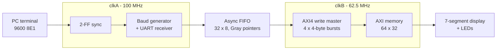

# UART-to-AXI4 Write Bridge with Asynchronous FIFO on FPGA

A Verilog design that receives characters from a PC over UART and writes them into an on-chip memory as AXI4 burst writes, crossing from a 100 MHz clock domain to a 62.5 MHz clock domain through an asynchronous FIFO. It runs on a **Digilent Nexys 4 DDR** (Artix-7 `xc7a100tcsg324-1`) and was built with **Vivado 2024.2**.

## How it works



1. Each typed letter arrives as an 11-bit UART frame: start bit, 8 data bits (LSB first), even parity, stop bit.
2. A baud generator starts at the falling edge of the start bit and ticks once per bit, so every bit is sampled near its middle (10416 clocks per bit at 100 MHz).
3. Good bytes go into a 32-entry asynchronous FIFO. Read and write pointers cross between the clocks in Gray code through two-flop synchronizers.
4. When 16 bytes are available, the AXI master reads them, packs four bytes into each 32-bit word (first byte in the lowest byte) and writes four-beat INCR or WRAP bursts (AWLEN = 3, AWSIZE = 2).
5. The memory holds 64 words of 32 bits. Switches choose a word and the display shows it in hex.

## Results

| Item | Result |
|---|---|
| Simulation | 5 bursts, 80 bytes, all 64 words compared, ALL TESTS PASSED at 899.432 us |
| Timing (post-implementation) | WNS +4.761 ns, TNS 0, WHS +0.031 ns, WPWS +3.000 ns, 0 failing endpoints of 623 |
| Design rule check | No violations |
| CDC report | 28 of 28 constrained crossing endpoints Safe |
| Utilization | LUT, LUTRAM, FF, BRAM about 1% each; IO 20%; BUFG 9%; MMCM 17% |
| Power | Dynamic 0.128 W, static 0.098 W |

Screenshots: [timing](docs/images/timing_summary.png), [utilization](docs/images/utilization.png), [power](docs/images/power.png), [simulation waveform](docs/images/sim_full_waveform.png).

## Repository layout

```
src/          top.v, bridge.v, baud_gen.v, axi_mem_slave.v, seg7_driver.v
sim/          tb_system.v  (self-checking testbench)
constraints/  nexys4ddr.xdc
docs/images/  board photo, waveforms, timing, utilization, power
```

## Build it in Vivado 2024.2

1. Create a new RTL project for part `xc7a100tcsg324-1`.
2. Add the files in `src/` as design sources, `sim/tb_system.v` as a simulation source and `constraints/nexys4ddr.xdc` as constraints.
3. Create the **Clocking Wizard** IP with the name `clk_wiz_0`: input 100 MHz; `clk_out1` = 100 MHz (clkA); `clk_out2` = 62.5 MHz (clkB); leave the reset port unticked and keep the `locked` output.
4. Set `top` as the top module, then run synthesis, implementation and generate the bitstream.
5. Program the board.

The constraint file ends with a block that declares the two MMCM output clocks asynchronous. It is evaluated after the clocks exist, so synthesis prints warnings that no clocks matched. That is expected. Look for `CDC-XDC: applied` in the implementation log.

## Run the simulation

Set `tb_system` as the simulation top (not `top`) and run behavioral simulation. The testbench uses 1 Mbaud to keep the run short and sends five bursts: INCR at 0x00, WRAP at 0x18 (with one bad-parity frame), INCR at 0x40, INCR at 0x80 and WRAP at 0xC4, with bit-time errors up to 2%. It finishes with an all-tests-passed message.

## Test on the board

1. Open PuTTY: Serial, your COM port, **9600 baud, 8 data bits, parity Even, 1 stop bit, flow control None**. The window stays blank because the design only receives.
2. Put all switches down and press **btnC** (reset). LED3 should be on.
3. Type `ABCDEFGHIJKLMNOP` (16 letters). Select words with SW7 to SW2 (SW2 is the lowest bit):

| SW7-SW2 | Word | Letters | Display |
|---|---|---|---|
| 000000 | 0 | ABCD | 44434241 |
| 000001 | 1 | EFGH | 48474645 |
| 000010 | 2 | IJKL | 4C4B4A49 |
| 000011 | 3 | MNOP | 504F4E4D |

4. Without a reset, type `QRSTUVWXYZ012345`. Words 4 to 7 show `54535251`, `58575655`, `31305A59`, `35343332`.

The display reads reversed from the typed order because the first byte is stored in the lowest 8 bits and the display shows the highest byte on the left.

### Board controls

| Item | Function |
|---|---|
| btnC | Reset |
| SW0 | 1 = WRAP bursts, 0 = INCR bursts (read at the start of a burst) |
| SW9 | Adds an 8-byte offset to the burst start address |
| SW7-SW2 | Memory word shown on the display |
| LED0 | Parity error (latched) |
| LED1 / LED2 | FIFO full / empty |
| LED3 | Clock locked |
| LED7-LED4 | Completed bursts (count) |
| LED13-LED8 | Write pointer (bytes received, modulo 64) |

## Limitations

- Write-only bridge with one fixed burst (four 32-bit beats); not a full AXI4 master. No byte strobes, IDs, write back-pressure or error-response handling.
- Receiver has no oversampling, noise filtering or framing-error flag. A byte with a bad parity bit is stored and LED0 is raised.
- No transmit path. A final group of fewer than 16 bytes stays in the FIFO.
- Switch inputs and the memory-to-display path are not synchronized (slow, human-driven signals).
- The project defines the 100 MHz input clock twice (IP and board XDC), which triggers Vivado methodology warnings but does not affect results.
- On the board, incrementing bursts at 9600 baud were tested. WRAP mode and the parity-error path were verified in simulation only.

## Future work

UART transmit path and AXI read channel, error handling and back-pressure, synchronizers on the switch inputs, removal of the duplicate clock definition, higher baud rates, and a coverage-driven testbench.

## License

MIT. See [LICENSE](LICENSE).
